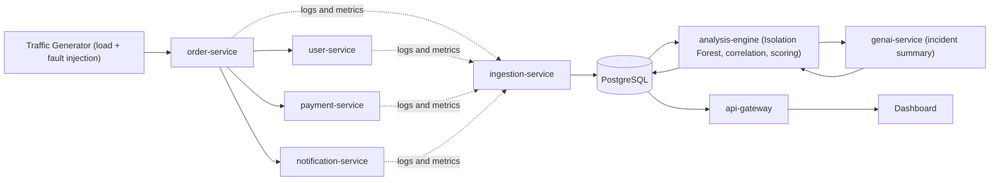

# 🧠 OpsMind: AI-Powered Incident Detection & Root-Cause Analysis Platform

> When a production system starts failing, engineers dig through thousands of log lines to answer one question: **what actually caused it?** OpsMind answers that automatically.


OpsMind is a self-contained, containerized platform that **generates its own microservice traffic, injects realistic production failures, detects anomalies with machine learning, works out which service is the true root cause (not just the loudest symptom), and uses GenAI to explain the incident in plain English.**


---

## ✨ Highlights

- **Real distributed system, not a static dataset:** 4 FastAPI microservices with a real dependency chain, plus a traffic generator that creates its own incident data.
- **4 injected failure scenarios:** database latency with connection-pool exhaustion, memory leak, bad deployment, and network latency.
- **Unsupervised anomaly detection:** Isolation Forest fitted per service on a rolling metrics window, so no labelled data and no hand-tuned thresholds.
- **Causation, not just correlation:** a topology-aware scoring engine ranks every service as a root-cause candidate using timing, the dependency graph, deployments, and error volume.
- **GenAI used safely:** the LLM only *narrates* evidence that the deterministic engine has already scored. It never picks the root cause, which removes the hallucination risk from the part that matters.
- **One-command startup:** 10 containers orchestrated with Docker Compose, with a live dashboard.

---

## 🏗️ Architecture



### The three levels

| Level | What it does | Where |
|---|---|---|
| 🟢 **Engineering** | Microservices, telemetry ingestion, Postgres, Docker Compose | `services/*`, `docker-compose.yml` |
| 🟡 **Intelligence** | Anomaly detection, event correlation, root-cause scoring | `services/analysis-engine/` |
| 🔴 **AI** | Plain-English incident reports and investigation steps | `services/genai-service/` |

---

## 🔍 How It Works

1. **Generate:** the traffic generator sends continuous orders through `order-service`, which calls user, payment, and notification services. Every 60s of normal traffic it injects one of four incidents for ~90s, then resets.
2. **Collect:** each service pushes structured logs, metrics (CPU, latency, error rate, memory, connection-pool usage), and deployment events to the ingestion service, which stores them in PostgreSQL.
3. **Detect:** every 10 seconds the analysis engine fits an **Isolation Forest** per service on the last 6 minutes of metrics and flags anomalies from the most recent 15 seconds, so it catches the *onset* of a problem instead of re-flagging the same one.
4. **Correlate:** anomalies within 90 seconds of each other are clustered into one incident.
5. **Score:** every affected service is ranked as a root-cause candidate (formula below), with human-readable evidence.
6. **Explain:** the GenAI layer turns the scored evidence into a summary and investigation checklist.
7. **Show:** the dashboard displays active incidents, the ranked candidates, the timeline, and the AI report.

### Root-cause scoring formula

```
score = 0.30 × temporal + 0.25 × dependency + 0.25 × deployment + 0.20 × errors
```

| Signal | Meaning |
|---|---|
| **Temporal** | Did this service's anomaly appear *first*? Causes precede effects. |
| **Dependency** | Do other affected services depend on this one, per the service graph? |
| **Deployment** | Was there a deployment to this service in the 10 minutes before impact? |
| **Errors** | How many ERROR log lines did this service produce, relative to the other candidates? |

This is what separates a cause from a victim. In a database-latency incident, `order-service` also shows errors, but it ranks below `payment-service` because its anomaly came later, nothing depends on it, and it had no recent deployment.

---

## 💥 Incident Scenarios

| Scenario | What is injected | Expected result |
|---|---|---|
| **Database latency** | Payment service slows down, its connection pool fills up, and requests time out | `payment-service` ranked root cause, `order-service` flagged as downstream |
| **Memory leak** | Payment service memory climbs until a simulated OOM restart | Memory anomaly on `payment-service` |
| **Bad deployment** | Order service ships `v2.4.1` and starts throwing exceptions directly | `order-service` ranked root cause (no upstream culprit) |
| **Network latency** | Payment gateway calls slow down and intermittently time out | Latency and error anomalies on `payment-service` |

---

## 🧰 Tech Stack

| Layer | Technology |
|---|---|
| Services & APIs | Python, FastAPI, Uvicorn, httpx |
| Database | PostgreSQL 16 |
| Machine learning | scikit-learn (Isolation Forest), NumPy |
| GenAI | Anthropic Claude API (with a deterministic fallback) |
| Containers | Docker, Docker Compose |
| Frontend | HTML, CSS, JavaScript, served by nginx |

---

## 🚀 Quick Start

**Prerequisites:** [Docker Desktop](https://www.docker.com/products/docker-desktop/) installed and running (about 4 GB free RAM).

```bash
git clone https://github.com/Jahnavisingh05/opsmind.git
cd opsmind

# Optional: enable real Claude-generated reports
cp .env.example .env        # then add your ANTHROPIC_API_KEY

docker compose up --build
```

Without an API key everything still works: the GenAI service falls back to a template-based summary built from the same evidence.

| URL | What |
|---|---|
| http://localhost:3000 | **Dashboard** |
| http://localhost:8088/api/overview | API gateway |
| http://localhost:8006/health | Analysis engine |
| http://localhost:8007/health | GenAI service |

Allow **2-3 minutes** for the traffic generator to warm up and inject the first incident.

### Trigger an incident on demand

```bash
curl -X POST "http://localhost:8003/admin/deploy?version=v1.9.0&description=add%20loyalty%20query"
curl -X POST "http://localhost:8003/admin/fault?mode=db_latency"
curl -X POST http://localhost:8006/run-now      # force an analysis cycle
curl -X POST "http://localhost:8003/admin/reset"
```

### Stop and reset

```bash
docker compose down         # stop
docker compose down -v      # stop and wipe the database for a clean demo
```

---

## 📁 Project Structure

```
opsmind/
├── docker-compose.yml
├── init-db/01_schema.sql            # logs, metrics, deployments, incidents, ...
├── services/
│   ├── common/emitter.py            # shared telemetry helper
│   ├── user-service/
│   ├── order-service/
│   ├── payment-service/
│   ├── notification-service/
│   ├── ingestion-service/           # receives logs, metrics, deployments
│   ├── analysis-engine/
│   │   ├── anomaly_detector.py      # Isolation Forest
│   │   ├── rootcause.py             # clustering + scoring
│   │   ├── dependency_graph.py      # service topology
│   │   └── main.py                  # 10s analysis loop
│   ├── genai-service/               # LLM incident reports
│   └── api-gateway/                 # read API for the dashboard
├── traffic-generator/               # load + fault injection
└── dashboard/index.html
```

---

## 🧠 Design Decisions

- **Why Isolation Forest?** It is unsupervised, so it needs no labelled incidents, and it refits quickly on each service's own recent window. That handles different "normal" baselines per service better than a fixed threshold.
- **Why keep GenAI out of detection?** An LLM asked to find a root cause from raw logs can sound confident and be wrong. Here the deterministic engine decides, and the LLM only explains the scored evidence, with the prompt telling it to treat that evidence as data, not instructions.
- **Why HTTP ingestion instead of Kafka?** It keeps the project dependency-free while proving the same decoupled pattern. Kafka is the natural next step (see below).
- **Why a graceful fallback for the LLM?** If the API key is missing or the call fails, the system degrades to a template summary instead of breaking.
- **Why simulate faults with state flags?** Incidents can be switched on and off repeatably, which makes the system demoable and gives free ground truth for validation.

---

## ⚠️ Known Limitations

- **False positives early on:** Isolation Forest uses a fixed `contamination=0.2`, so a window of purely normal traffic still produces some flagged points. A longer baseline or a stricter score threshold would reduce this.
- **Polling, not streaming:** the analysis engine queries Postgres every 10 seconds. This won't scale to hundreds of services.
- **Static dependency graph:** the service topology is hand-defined, not discovered from traces.
- **Hand-tuned weights:** the scoring weights are chosen by judgement, not learned.
- **Simulated environment:** results come from injected faults in a local system, not real production traffic.

## 🔭 Future Work

- Replace HTTP ingestion and DB polling with **Kafka** and make the analysis engine an event consumer.
- Build the dependency graph from **OpenTelemetry** traces.
- Learn the scoring weights from the known injected faults (for example with logistic regression) and report root-cause accuracy over many runs.
- Add **Prometheus + Grafana** and a React dashboard.
- Compare Isolation Forest against One-Class SVM on false-positive rate.

---

## 👩‍💻 Author

**Jahnavi Singh**: final-year B.Tech Computer Science (Honors in Data Analytics), KJ Somaiya School of Engineering, Mumbai.

[GitHub](https://github.com/Jahnavisingh05)


